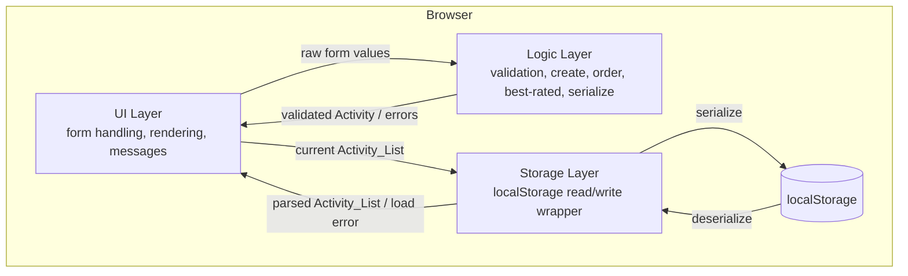
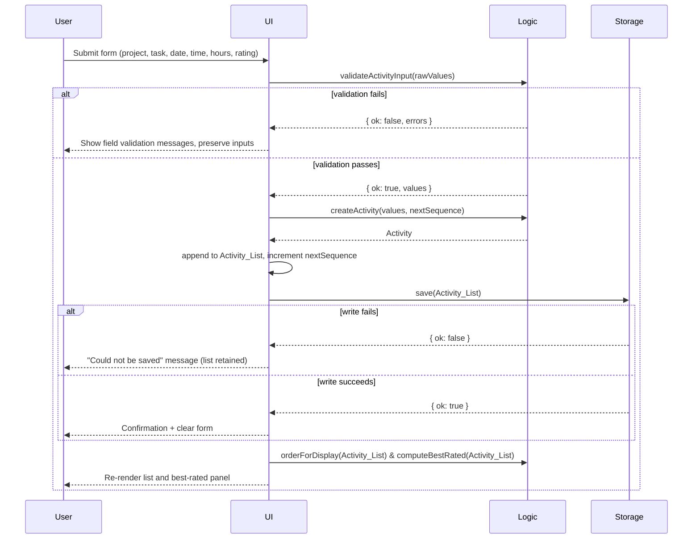

# Design Document

## Overview

ActivityTracker is a single-page web application built with plain HTML, CSS, and JavaScript, with no backend server. It lets a user log activities (project, task, date, time, hours), rate each activity with a 1-to-5 "Liked" star rating, persist all activities in the browser's `localStorage`, review the full activity list, and see the best-rated activity at a glance.

The design keeps a clean separation between three concerns so that the testable logic is isolated from the DOM and from the browser storage API:

- A **pure domain/logic layer** (validation, Activity creation, ordering, best-rated computation, serialization) that takes inputs and returns outputs with no side effects. This layer is where property-based testing provides the most value.
- A **storage layer** that wraps `localStorage` read/write and isolates persistence failures and parse errors.
- A **UI layer** that reads the form, invokes the logic layer, renders the activity list and best-rated panel, and shows validation and status messages.

### Design Goals and Constraints

- No backend, no build step required: a single `index.html` plus `styles.css` and `app.js` (ES modules) that run directly in the browser.
- Persistence strictly through `localStorage`.
- Keep domain logic as pure functions so behavior is deterministic and testable across many generated inputs.
- Degrade gracefully when storage is unavailable or stored data is corrupt, without destroying the user's unparseable data.

### Research Notes

- **`localStorage` capacity and failures**: `localStorage` stores string key/value pairs synchronously and can throw `QuotaExceededError` when full, or throw on access when disabled (e.g., private browsing in some browsers, or blocked third-party storage). Because of this, all access is wrapped in `try/catch` so a failure surfaces as a user-facing message rather than an uncaught exception. See [MDN: Window.localStorage](https://developer.mozilla.org/en-US/docs/Web/API/Window/localStorage). Content was rephrased for compliance with licensing restrictions.
- **Serialization**: Activities are serialized with `JSON.stringify` and read back with `JSON.parse`. `JSON.parse` throws `SyntaxError` on malformed input, which the storage layer catches to satisfy the "unparseable data" requirement (3.5). See [MDN: JSON.parse](https://developer.mozilla.org/en-US/docs/Web/JavaScript/Reference/Global_Objects/JSON/parse). Content was rephrased for compliance with licensing restrictions.
- **Ordering by date and time**: Requirement 4.4 orders by date and time with most recent first, while Requirements 5.3 breaks rating ties by "most recently added." These are two distinct orderings, so each Activity carries both a combined date-time value (for display ordering) and a monotonic insertion sequence number (for recency-of-addition tie-breaking). This avoids conflating "recorded date/time" with "when the user added the record."

## Architecture

The application is a single HTML page. JavaScript is organized into modules by responsibility. Data flows one direction on each user action: the UI gathers input, the logic layer validates and computes, the storage layer persists, and the UI re-renders from the resulting in-memory state.



### Module Responsibilities

- `validation.js` — Pure functions that validate raw form input and the Liked_Rating.
- `activity.js` — Pure functions to create an Activity, order the Activity_List, and compute the Best_Rated_Activity.
- `serialization.js` — Pure functions to serialize an Activity_List to a string and parse a string back into an Activity_List.
- `storage.js` — Thin wrapper over `localStorage` that uses `serialization.js` and converts browser errors into typed results.
- `ui.js` / `app.js` — Wires DOM events to the logic and storage layers, renders the list and best-rated panel, and displays validation/status messages.

### Application State

A single in-memory `state` object holds the authoritative `Activity_List` and a monotonic `nextSequence` counter. The UI always renders from this in-memory state; storage is written after each successful mutation. If a storage write fails, the in-memory state is retained (Requirement 3.2) so the user does not lose the just-added activity.

### Event Flow: Adding an Activity



## Components and Interfaces

### Validation (`validation.js`)

```js
/**
 * Validate raw form input for an activity.
 * @param {{project:string, task:string, date:string, time:string, hours:string|number, rating:number|null}} raw
 * @returns {{ ok: true, values: ValidatedInput } | { ok: false, errors: FieldErrors }}
 */
export function validateActivityInput(raw) {}

/**
 * @param {*} rating
 * @returns {boolean} true iff rating is an integer in [1, 5]
 */
export function isValidRating(rating) {}
```

- `FieldErrors` is an object keyed by field name (`project`, `task`, `date`, `time`, `hours`, `rating`) whose values are human-readable messages. Only invalid fields appear.
- Validation rules:
  - `project`, `task`, `date`, `time`: rejected when empty or whitespace-only.
  - `hours`: rejected unless it parses to a finite number strictly greater than 0.
  - `rating`: rejected unless `isValidRating` returns true (integer 1–5).
- Validation never mutates `raw`; the UI preserves the user's entered values on rejection (Requirements 1.9, 2.3).

### Activity Operations (`activity.js`)

```js
/**
 * Build an immutable Activity from validated values.
 * @param {ValidatedInput} values
 * @param {number} sequence monotonic insertion counter
 * @returns {Activity}
 */
export function createActivity(values, sequence) {}

/**
 * Order activities for display: by date+time descending (most recent first).
 * Ties broken by insertion sequence descending. Returns a new array.
 * @param {Activity[]} list
 * @returns {Activity[]}
 */
export function orderForDisplay(list) {}

/**
 * Compute the best-rated activity: highest Liked_Rating, ties broken by the
 * most recently added (highest sequence). Returns null for an empty list.
 * @param {Activity[]} list
 * @returns {Activity | null}
 */
export function computeBestRated(list) {}
```

### Serialization (`serialization.js`)

```js
/**
 * @param {Activity[]} list
 * @returns {string} JSON text
 */
export function serialize(list) {}

/**
 * @param {string} text
 * @returns {{ ok: true, list: Activity[] } | { ok: false }}
 * Returns ok:false when text is not valid JSON or not a well-formed Activity_List.
 */
export function deserialize(text) {}
```

### Storage (`storage.js`)

```js
const STORAGE_KEY = 'activity-tracker.activities.v1';

/**
 * @param {Activity[]} list
 * @returns {{ ok: true } | { ok: false }} ok:false when localStorage throws.
 */
export function save(list) {}

/**
 * @returns {{ status: 'loaded', list: Activity[] }
 *          | { status: 'empty', list: [] }
 *          | { status: 'corrupt', list: [] }}
 * 'empty' when no stored value exists; 'corrupt' when the stored value cannot
 * be parsed (the raw stored value is left untouched).
 */
export function load() {}
```

### UI (`ui.js` / `app.js`)

Responsibilities (not pure; interacts with the DOM):

- Render the activity form with fields for project, task, date, time, hours, and a 5-position star control (Requirements 1.1, 2.1).
- On submit: read raw values, call `validateActivityInput`, render field errors or proceed.
- Render the Activity_List using `orderForDisplay`, each row showing project, task, date, time, hours, and the Liked_Rating as filled stars out of five (Requirements 4.1, 2.5).
- Render the best-rated panel using `computeBestRated` (Requirement 5.1), or an empty-state message when the list is empty (Requirements 4.3, 5.4).
- Show a confirmation after a successful add and clear the form (Requirement 1.3).
- Show status messages for storage write failure (Requirement 3.2) and load/parse failure (Requirement 3.5).

## Data Models

### Activity

| Field | Type | Description | Constraints |
|-------|------|-------------|-------------|
| `id` | string | Unique identifier for the activity | Generated at creation (e.g., `crypto.randomUUID()` with a fallback) |
| `project` | string | Project label | Non-empty after trimming |
| `task` | string | Task label | Non-empty after trimming |
| `date` | string | Calendar date (ISO `YYYY-MM-DD` from the date input) | Non-empty |
| `time` | string | Time of day (`HH:MM` from the time input) | Non-empty |
| `hours` | number | Duration in hours | Finite number > 0 |
| `rating` | number | Liked_Rating | Integer in [1, 5] |
| `sequence` | number | Monotonic insertion counter | Assigned at add time; strictly increasing |

Notes:
- `date` + `time` together form the sort key used by `orderForDisplay` (lexical comparison of the combined `date + 'T' + time` string works because both are zero-padded fixed-width formats).
- `sequence` captures the order of addition and is the tie-breaker for both display ordering and best-rated selection. It is independent of `date`/`time`.

### ValidatedInput

The normalized output of `validateActivityInput` on success: `project` and `task` trimmed, `hours` coerced to a `number`, `rating` an integer in [1, 5], `date` and `time` as the raw non-empty strings.

### Persisted Shape

`localStorage[STORAGE_KEY]` holds `JSON.stringify(Activity[])` — an array of Activity objects as above. The storage key is versioned (`.v1`) so a future schema change can migrate without colliding with old data.

### In-Memory State

```js
const state = {
  activities: [], // Activity[]
  nextSequence: 0, // number, max existing sequence + 1 after load
};
```

## Correctness Properties

*A property is a characteristic or behavior that should hold true across all valid executions of a system — essentially, a formal statement about what the system should do. Properties serve as the bridge between human-readable specifications and machine-verifiable correctness guarantees.*

The properties below were derived from the acceptance criteria. Pure-logic criteria (validation, ordering, best-rated selection, serialization, and precise rendering invariants) are expressed as universally quantified properties. UI-structure checks, empty-state messages, and storage-wiring/error-handling behaviors are covered by example and integration tests in the Testing Strategy rather than as properties.

### Property 1: Adding a valid activity grows the list and preserves its values

*For any* Activity_List and any set of valid input values (non-empty project, task, date, time; hours a finite number greater than 0; rating an integer in 1–5), creating an Activity and appending it to the list SHALL produce a list whose length is exactly one greater, and the appended Activity SHALL carry the submitted project, task, date, time, hours, and rating.

**Validates: Requirements 1.2**

### Property 2: Missing required fields are rejected with a field-specific error

*For any* raw form input in which at least one required field (project, task, date, time, or rating) is empty, whitespace-only, or unset — with all other fields valid — validation SHALL reject the submission and SHALL include an error entry for each missing field and for no valid field.

**Validates: Requirements 1.4, 1.5, 1.6, 1.7, 2.3**

### Property 3: Non-positive or non-numeric hours are rejected

*For any* raw form input whose hours value is not a finite number strictly greater than 0 (including zero, negatives, NaN, and non-numeric strings), with all other fields valid, validation SHALL reject the submission and SHALL include an error identifying the hours field.

**Validates: Requirements 1.8**

### Property 4: Rating validity is exactly the integers 1 through 5

*For any* value, `isValidRating` SHALL return true if and only if the value is an integer in the inclusive range 1 to 5; all other values (0, 6 and above, negatives, non-integers, and non-numbers) SHALL be rejected.

**Validates: Requirements 2.4, 2.3**

### Property 5: Validation never mutates the user's input

*For any* raw form input, calling `validateActivityInput` SHALL NOT modify that input, so the values the user already entered are preserved regardless of whether validation succeeds or fails.

**Validates: Requirements 1.9, 2.3**

### Property 6: Serialize/deserialize round trip preserves the list and its order

*For any* Activity_List, serializing it and then deserializing the result SHALL produce a list that is deeply equal to the original and in the same order.

**Validates: Requirements 3.3**

### Property 7: Deserialize rejects any ill-formed stored data

*For any* string that is not a valid serialized Activity_List (malformed JSON, or valid JSON whose shape is not an array of well-formed Activity records), `deserialize` SHALL return a failure result rather than a parsed list.

**Validates: Requirements 3.5**

### Property 8: Display order is a sorted permutation by date and time, most recent first

*For any* Activity_List, `orderForDisplay` SHALL return a permutation of the input (same elements, no additions or removals) that is ordered so that each Activity's combined date-and-time is greater than or equal to the next Activity's, with the insertion sequence (most recently added first) breaking ties.

**Validates: Requirements 4.4**

### Property 9: A rendered row shows every Activity field

*For any* Activity, the rendered list row SHALL contain the Activity's project, task, date, time, hours, and Liked_Rating.

**Validates: Requirements 4.1**

### Property 10: A rating renders as that many filled stars out of five

*For any* Activity with rating r, rendering its Liked_Rating SHALL produce exactly r filled star positions and exactly five total star positions.

**Validates: Requirements 2.5**

### Property 11: The best-rated activity has the highest rating, ties broken by most recently added

*For any* non-empty Activity_List, `computeBestRated` SHALL return an Activity whose Liked_Rating equals the maximum rating in the list, and among all activities sharing that maximum rating it SHALL return the one with the highest insertion sequence (the most recently added).

**Validates: Requirements 5.1, 5.2, 5.3**

## Error Handling

| Scenario | Trigger | Handling | Requirement |
|----------|---------|----------|-------------|
| Invalid form field(s) | Empty/whitespace required field, hours not > 0, or no rating selected | Reject submission, show per-field validation messages, keep all entered values | 1.4–1.9, 2.3 |
| Out-of-range rating supplied | Rating not an integer in 1–5 | Reject the rating value; it is never stored | 2.4 |
| Storage write failure | `localStorage.setItem` throws (quota exceeded or storage disabled) | Catch the error, keep the Activity_List in memory, show "activity could not be saved"; the just-added activity remains visible | 3.2 |
| No stored data | Storage key absent on load | Initialize Activity_List as empty (normal first-run path, no error shown) | 3.4 |
| Corrupt/unparseable stored data | `JSON.parse` throws or shape is invalid on load | Initialize Activity_List as empty, leave the raw stored value untouched (do not overwrite), show "stored activities could not be loaded" | 3.5 |

Principles:
- All `localStorage` access is wrapped in `try/catch`; browser exceptions never propagate uncaught.
- On a load parse failure, the application does not write back to storage, so the user's unparseable data is preserved for potential manual recovery (Requirement 3.5).
- In-memory state is the source of truth for rendering, so a persistence failure never blanks the UI.

## Testing Strategy

The project uses a dual approach: property-based tests for universal logic properties and example/integration tests for UI structure, empty states, and storage wiring/error handling.

### Tooling

- **Test runner**: [Vitest](https://vitest.dev/) with `jsdom` environment for DOM-touching tests. Run once (non-watch) with `vitest --run`.
- **Property-based testing library**: [fast-check](https://fast-check.dev/), the standard PBT library for JavaScript/TypeScript. Property tests are not implemented from scratch.
- **DOM assertions**: jsdom via Vitest for rendering and interaction examples.

### Property-Based Tests

- Each correctness property above is implemented with a **single** fast-check property test.
- Each property test runs a **minimum of 100 iterations** (`{ numRuns: 100 }` or higher).
- Each test is tagged with a comment referencing its design property, using the format:
  `// Feature: activity-tracker, Property {number}: {property_text}`
- Generators:
  - A `validInput` arbitrary producing valid project/task (non-empty after trim), date (`YYYY-MM-DD`), time (`HH:MM`), hours (float > 0), and rating (integer 1–5).
  - An `invalidField` arbitrary that blanks or whitespace-fills one required field at a time (Property 2).
  - An `invalidHours` arbitrary mixing `<= 0`, `NaN`, and non-numeric strings (Property 3).
  - An `anyRating` arbitrary mixing integers, floats, out-of-range numbers, and non-numbers (Property 4).
  - An `activityList` arbitrary building lists with assigned sequence numbers, deliberately forcing rating ties (Property 11) and date/time collisions (Property 8).
  - A `malformedStored` arbitrary producing non-JSON strings and valid-JSON-but-wrong-shape values (Property 7).

| Property | Generator focus | Key assertion |
|----------|-----------------|---------------|
| P1 | valid input + arbitrary list | length + 1; appended values match |
| P2 | one missing required field | rejected; error for that field only |
| P3 | invalid hours | rejected with hours error |
| P4 | any value | valid iff integer in [1,5] |
| P5 | arbitrary raw input | input deep-equal before/after validate |
| P6 | activity lists | deserialize(serialize(l)) deep-equals l, same order |
| P7 | malformed strings | deserialize returns failure |
| P8 | lists with date/time ties | permutation; non-increasing by (date+time, sequence) |
| P9 | single activity | row contains all six fields |
| P10 | rating 1–5 | filled == rating; total == 5 |
| P11 | non-empty lists with ties | result rating == max; max sequence among maxima |

### Example-Based Unit Tests

- Form renders fields for project, task, date, time, hours, and a 5-position star control (Requirements 1.1, 2.1).
- Selecting each star value 1–5 renders that many filled stars (Requirement 2.2).
- After a successful add: confirmation shown and form cleared (Requirement 1.3); new row appears in the list (Requirement 4.2).
- Empty list shows the "no activities logged" message (Requirement 4.3).
- Non-empty list renders the best-rated panel with all six fields (Requirement 5.1).
- `computeBestRated([])` is null and the best-rated panel shows the "no best-rated activity" message (Requirement 5.4).
- `load()` with no stored key returns empty (Requirement 3.4).

### Integration Tests

- After adding an activity, storage receives the complete current Activity_List serialized (Requirement 3.1), using a mock `localStorage`.
- With `setItem` configured to throw, the in-memory list is retained and the "could not be saved" message is shown (Requirement 3.2).
- With a corrupt stored value, load yields an empty list, the raw stored value is left unchanged, and the "could not be loaded" message is shown (Requirement 3.5).
- Adding an activity triggers recomputation of the best-rated activity and updates the panel (Requirement 5.2).

Together, property tests verify the universal correctness of the logic layer while example and integration tests confirm the concrete UI behavior, empty states, and storage error handling that do not benefit from randomized input.
